# Microsoft Copilot で Rimo を使う

[English](../en/rimo-in-microsoft.md) | [日本語](../ja/rimo-in-microsoft.md)

Rimo を **Microsoft Copilot Studio のエージェント** につなぐと、Microsoft Teams や Microsoft 365 Copilot の中で自分のミーティングノートについて質問できます。エージェントが Rimo を調べて答えてくれます。

- *「Rimo のノートで、月曜の打ち合わせで何が決まった？」*
- *「Rimo の先週のクライアント面談を要約して。」*

Rimo は、Copilot Studio エージェントに **ツール**（ホスト型の MCP サーバー）として追加します。エージェント作成者が一度 Rimo を追加すれば、エージェントの公開後は各従業員がそれを開いて、自分の Rimo アカウントでサインインするだけです。

**追加するサーバー URL:**

```
https://mcp.rimo.app/mcp
```

> **すでに Copilot Studio エージェントをお持ちですか?** 新しく作る必要はありません。**[エージェントに Rimo MCP を追加する](#add-rimo-mcp-to-your-agent)** に直接進み、その後テストと公開に戻ってください。

> Claude、ChatGPT、Gemini をお使いですか? [Claude で Rimo を使う](rimo-in-claude.md)、[ChatGPT で Rimo を使う](rimo-in-chatgpt.md)、[Gemini で Rimo を使う](rimo-in-gemini.md) を参照してください。

---

## Microsoft の組織向けセットアップの仕組み

大きく分けて 3 つのパートがあります。

1. **エージェント作成者**（エージェントを作成・管理する人）が Copilot Studio エージェントを 1 つ作り、Rimo MCP をツールとして追加します。
2. **管理者** が公開されたエージェントを承認し、組織全体から見つけられるようにします。
3. 各 **エンドユーザー** がエージェントを開いて Rimo にサインインします。

Rimo は **ユーザーごとの認証** を使います。各ユーザーは、自分の Rimo アカウントで閲覧権限があるノートしか参照できません。誰かが初めて Rimo を必要とする質問をすると、Copilot Studio がその人に Rimo へのサインインを求めます。その後は接続が有効なままになり、期限切れや切断が起きたときだけ再度サインインが求められます。[Microsoft のユーザー認証ガイド](https://learn.microsoft.com/ja-jp/microsoft-copilot-studio/configure-enduser-authentication) を参照してください。

ここで説明する組織向けの展開では、Microsoft のアカウントは **同じ Microsoft Entra テナント** に属している必要があります。各ユーザーには **自分の Rimo アカウント** も必要です。Microsoft のメールアドレスと Rimo のメールアドレスは一致している必要はありません（一致していても問題はなく、違いはありません）。

---

## Copilot Studio エージェントを作成する

すでにエージェントをお持ちの場合はこのセクションを飛ばして、[エージェントに Rimo MCP を追加する](#add-rimo-mcp-to-your-agent) に進んでください。

1. [Microsoft Copilot Studio](https://copilotstudio.microsoft.com/) にサインインし、使いたい環境を選びます。
2. 左メニューの **エージェント（Agents）** を開き、**新しいエージェント（New agent）** を選びます。Copilot Studio が名前のない下書きを作成し、**ビルド（Build）** ビューで開きます。
3. 上部の名前を選んでエージェント名を入力します（例: `Rimo`）。**指示（Instructions）** に動作を記述します — 下記の [推奨するエージェントの指示](#recommended-agent-instructions) を参照してください。
4. Copilot Studio はエージェントを **Microsoft Entra ID** 認証用に自動で構成します。オンのままにしてください。

> **作成時から Copilot クレジットを使います。** **新しいエージェント（New agent）** で作成したエージェントは **Microsoft Copilot ハーネス** で動作します（**エージェント（Agents）** 一覧の **Agent harness** 列に表示されます）。作成中やテスト中も Copilot クレジットを使うため、作成を始める前に環境にクレジットが必要です — [Microsoft のプランを選ぶ](#choose-your-microsoft-plan) を参照してください。

詳しい手順は [エージェントの作成と編集](https://learn.microsoft.com/ja-jp/microsoft-copilot-studio/authoring-first-bot) を参照してください。

<a id="recommended-agent-instructions"></a>

### 推奨するエージェントの指示

明確な指示があると、エージェントは Rimo に基づいて回答し、事実でない内容を作り出さなくなります。次のような内容をエージェントの **指示（Instructions）** に貼り付け、必要に応じて調整してください。

```text
あなたは、サインイン中のユーザーが自分の Rimo ミーティングノートから情報を見つけ、理解するのを手伝います。接続されたツールを通じて Rimo に読み取り専用でアクセスでき、参照できる範囲はユーザーの Rimo アカウントと組織によって決まります。

- ユーザーのミーティング、ノート、文字起こし、決定事項、参加者、ドキュメントに関することは、回答する前に必ず Rimo のツールを呼び出してください。
- 回答は Rimo のツールが返した内容だけに基づいてください。ツールの結果に含まれない情報は「わからない」と答え、推測や創作をしないでください。
- 関連する情報が見つからない場合は、その旨を明確に伝えてください。Rimo へのアクセスは読み取り専用です。ノートを作成・編集・共有・削除したと述べないでください。
- ミーティング・人物・チーム・日付が曖昧な場合は、先に短い確認の質問を 1 つしてください。
- 簡潔に答えてください。まず結論を述べ、続いて根拠を簡潔に示し、参照したノートのタイトルとミーティング日を挙げてください。
```

---

<a id="add-rimo-mcp-to-your-agent"></a>

## エージェントに Rimo MCP を追加する

以下のセットアップは、エージェント作成者がエージェントの **ビルド（Build）** ビューで一度だけ行います。

1. 右側のパネルで **ツール（Tools）** の横の **＋** を選びます。**ツールの追加（Add a tool）** ダイアログが開きます。

   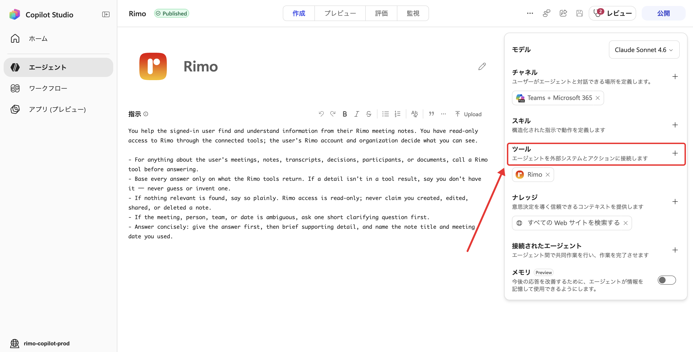

2. ダイアログで右上の **＋ 追加（Add）** を選び、**モデル コンテキスト プロトコル (MCP)** を選択します。

   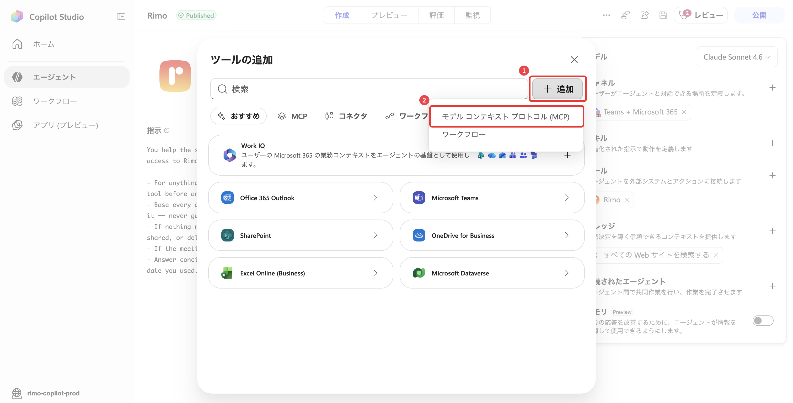

3. サーバーの詳細を入力します。
   - **アイコン（Icon）:** アイコンの枠を選び、Rimo のロゴ（PNG、30 KB 未満）をアップロードします。
   - **サーバー名（Server name）:** `Rimo`
   - **サーバーの説明（Server description）:** `Rimo — list, read, search, and ask across your meeting notes, transcripts, and documents.`
   - **サーバー URL（Server URL）:** `https://mcp.rimo.app/mcp`
   - **認証（Authentication）:** **OAuth 2.0**
   - **構成の種類（Configuration type）:** **動的 (検出あり)**

   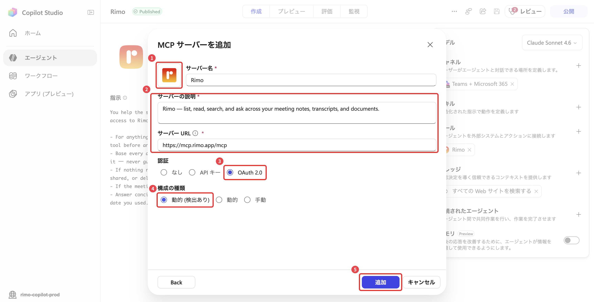

4. **追加（Add）** を選びます。Copilot Studio が接続を求めたら接続を作成し（[エージェント作成者として Rimo にサインインする](#sign-in-to-rimo-as-the-maker) を参照）、もう一度 **追加（Add）** を選んでエージェントに追加します。

[既存の MCP サーバーを Copilot Studio エージェントに接続する](https://learn.microsoft.com/ja-jp/microsoft-copilot-studio/mcp-add-existing-server-to-agent) を参照してください。

---

<a id="sign-in-to-rimo-as-the-maker"></a>

## エージェント作成者として Rimo にサインインする

ツールを追加する際、Copilot Studio はエージェント作成者に Rimo 接続の作成を求めます。

1. 接続パネルが **未接続（Not connected）** になっているとき、ドロップダウンを開いて **新しい接続を作成（Create new connection）** を選びます。

   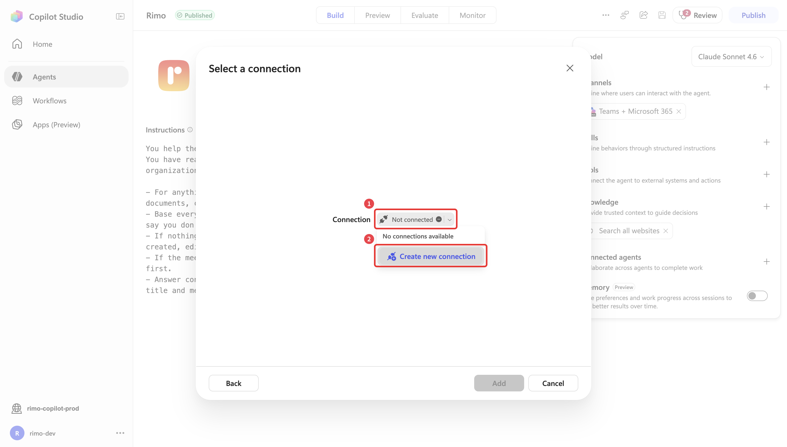

2. **作成（Create）** を選びます。

   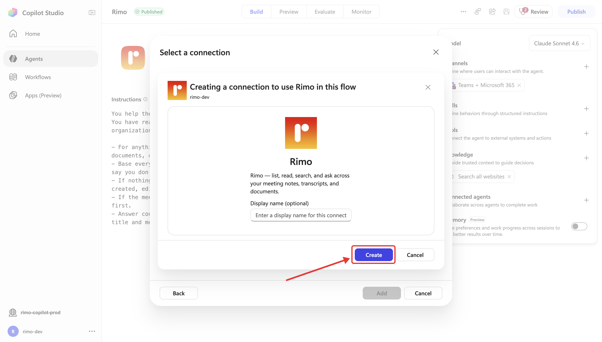

3. Rimo のページが開きます。いつもの Rimo アカウントでサインインし、接続がアクセスできる **組織** を選んで、**アクセスを許可（Allow access）** を選びます。組織を選ぶまでボタンは押せません。

   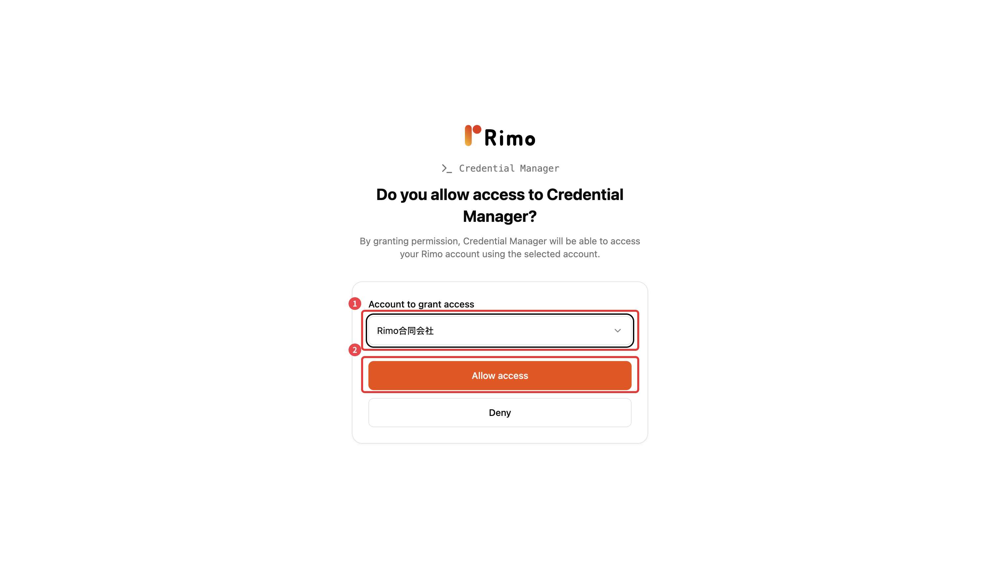

4. Copilot Studio に戻ると接続に緑のチェックが表示されます。**追加（Add）** を選びます。

このエージェント作成者の接続は作成とテストのためだけのものです。全従業員のための共通の資格情報として **共有されるわけではありません** — 各エンドユーザーは、展開後に自分の Rimo アカウントでサインインします。

---

## ツールをユーザーごとのサインインに設定する

Rimo ツールが、各従業員をエージェント作成者ではなく **本人の** Rimo アカウントでサインインさせる設定になっていることを確認します。

1. 右側パネルの **ツール（Tools）** で **Rimo** を選びます。**ツールを編集（Edit tool）** ダイアログが開きます — 別の **編集（Edit）** ボタンはありません。
2. 右上の **認証（Authentication）** ドロップダウンで **エンド ユーザー アカウント（End user account）** を選びます。

   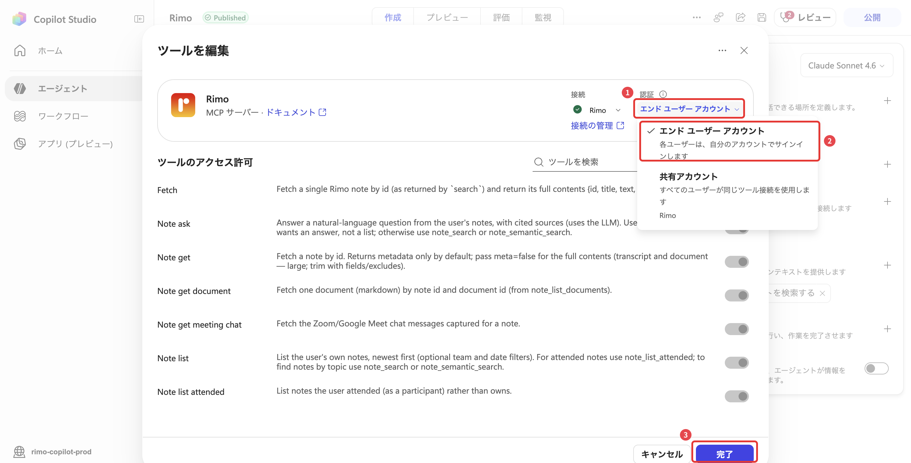

**エンド ユーザー アカウント（End user account）** は、各従業員が自分の Rimo アカウントでサインインし、自分のノートだけを見る設定です。**共有アカウント（Shared account）** を選ぶと、全員が作成者本人の 1 つの接続を共有してしまうため、使わないでください。**完了（Done）** を選びます。

---

## 公開前にテストする

1. エージェントの **プレビュー（Preview）** タブを開き、新しい会話を始めます。
2. こう尋ねます。

   ```text
   最近の Rimo のノートを見せて。
   ```

3. 初回は、Copilot が **アクセス許可が必要（Permission Required）** のカードを表示することがあります — **許可（Allow）** を選びます。するとエージェントがノートを返します。

   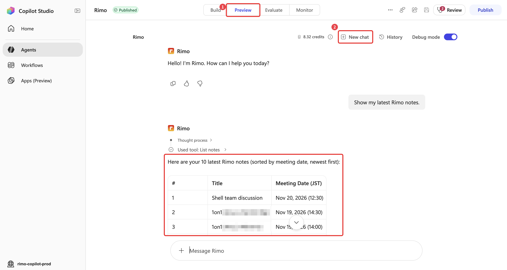

---

<a id="choose-your-microsoft-plan"></a>

## Microsoft のプランを選ぶ

この節は **Microsoft** についてのもので、エージェントを作成・公開・実行するために組織が Copilot Studio 側で必要とするものです。**Rimo のプランではありません**。Rimo はこの利用に対して課金せず、購入すべき特別な Rimo プランもありません — 各ユーザーは既存の Rimo アカウントでサインインするだけです。

### エージェントの Copilot クレジット

このガイドで作成するエージェントは **Microsoft Copilot ハーネス** で動作します。作成、テスト、そして Rimo ツールの呼び出しを含むすべての会話で Copilot クレジットを使います。Microsoft はこのハーネスについて Microsoft 365 Copilot ライセンスによる免除を記載しておらず、ライセンスを割り当ててもクレジットは増えません。エージェントがある環境に、次のいずれかの方法で Copilot クレジットを用意してください。

| 方法 | 設定場所 | 注意点 |
|---|---|---|
| **Copilot クレジット パック** | Microsoft 365 管理センター（**請求（Billing） → サービスの購入（Purchase services）**）で **Copilot Studio** を購入し、Power Platform 管理センター（**ライセンス（Licensing） → Copilot Studio → Copilot クレジットの管理（Manage Copilot Credits）**）で環境にクレジットを割り当てます | 月単位。未使用のクレジットは翌月に繰り越されません。既定の環境でも使えます |
| **従量課金** | Power Platform 管理センター → **ライセンス（Licensing） → 従量課金制プラン（Pay-as-you-go plans） → 新しい請求プラン（New billing plan）**。Azure サブスクリプションにひも付けます | **運用環境とサンドボックス環境のみ** — 既定の環境では使えません |
| **購入前プラン** | Azure portal | 1 年間の前払い Copilot クレジット |

クレジットがないと、作成・テスト・チャットが *「継続するにはクレジットが必要です（You need credits to continue）」* で止まります。

> **ほとんどのユーザーが Microsoft 365 Copilot ライセンスを持っている場合は?** **新しいエージェント（New agent）** の横の **▾** を開き、**Standard** と表示された **Agent** を選んでください。Copilot Studio は標準エージェントに *「It doesn't use Copilot Credits for users with a Microsoft 365 Copilot license.（Microsoft 365 Copilot ライセンスを持つユーザーには Copilot クレジットを使いません）」* と表示します。このライセンスを持たないユーザーは、引き続き環境のクレジットを使います。Rimo は **Tools → Add a tool → Add new MCP** から同じサーバー情報で追加します。ユーザーごとのサインインにするには、Rimo ツールを開き **Additional details** → **Credentials to use: End user credentials** を選びます。このガイドの画面は既定のエージェントのものです。

### エージェント作成者のライセンス

| Microsoft の構成 | 公開可否 |
|---|---|
| **Copilot Studio 試用版** | 不可 — テストパネルのみ |
| **Microsoft 365 Copilot** ライセンス | 可 |
| 無料の **Copilot Studio ユーザー ライセンス**（テナントに Copilot クレジット パックが必要） | 可 |
| **Copilot Studio 作成者** のセキュリティ グループ（従量課金を利用） | 可 |
| **Copilot Studio Teams プラン** | **本ガイドの対象外。** Teams プランには Power Platform コネクタがありませんが、Copilot Studio の MCP アクセスはそれに依存します |

公開後のエージェントの利用者に Copilot Studio ライセンスは不要です。ただし Teams などのチャネルへのアクセスは必要です。

[Copilot Studio のハーネス](https://learn.microsoft.com/ja-jp/microsoft-copilot-studio/harnesses-overview)、[Microsoft Copilot ハーネスの課金](https://learn.microsoft.com/ja-jp/microsoft-copilot-studio/agents-experience/billing-credit-overview)、[Copilot クレジットの管理](https://learn.microsoft.com/ja-jp/power-platform/admin/manage-copilot-studio-copilot-credits-capacity)、[従量課金の設定](https://learn.microsoft.com/ja-jp/power-platform/admin/pay-as-you-go-set-up)、[Copilot Studio のライセンス](https://learn.microsoft.com/ja-jp/microsoft-copilot-studio/billing-licensing)、および [Copilot Studio ライセンスガイド](https://go.microsoft.com/fwlink/?linkid=2320995) を参照してください。

---

## 組織へ公開するための役割

エージェント作成者がテナント管理者である必要はありません。

| タスク | 最小限の役割または権限 |
|---|---|
| エージェントの作成・設定・公開 | エージェントの所有者/編集者、および上記のエージェント作成者のライセンス |
| Microsoft 365 管理センターでエージェントを承認・管理 | **AI 管理者（AI Administrator）** |
| Teams アプリの公開範囲・自動インストール・ピン留めの管理 | **Teams 管理者（Teams Administrator）** |
| 公開されたエージェントの利用 | エージェントとそのチャネルにアクセスできる通常のテナントユーザー |

---

## Teams と Microsoft 365 Copilot に公開する

公開が可能なプランが必要です。試用版は前のテスト手順で止まります。

1. 右側のパネルで **チャネル（Channels）** の横の **＋** を選び、**Teams + Microsoft 365** を選びます。

   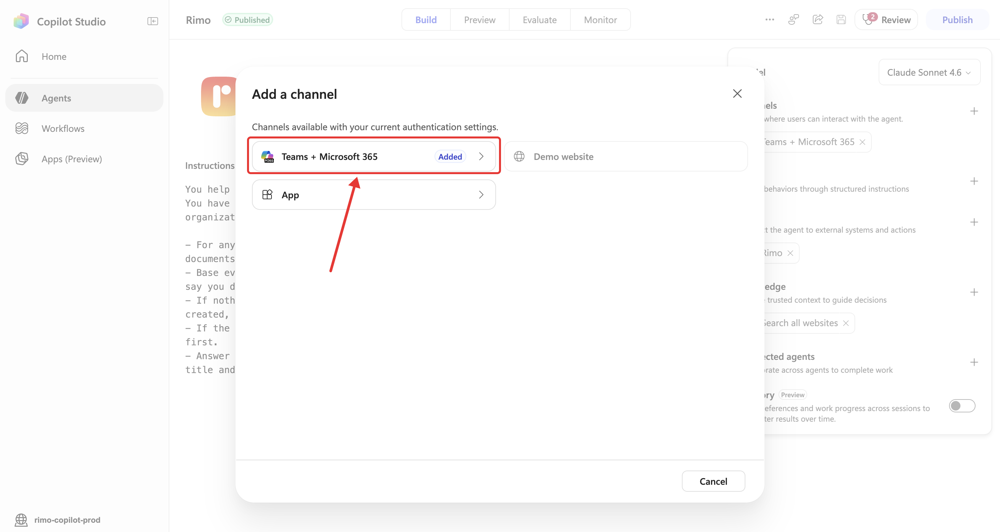

2. **利用可能な場所（Availability）** で、エージェントを Teams だけでなく Microsoft 365 Copilot でも動かすため **Microsoft Copilot and Microsoft Teams** を選択したままにし、**チャネルを追加（Add channel）** を選びます。

   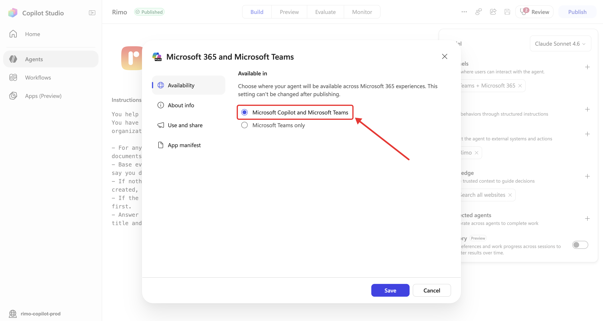

3. 右上の **公開（Publish）** を選び、**エージェントを公開（Publish agent）** を選びます。*「Your agent published successfully」*（エージェントが公開されました）と表示されるまで待ちます。
4. 右側パネルの **Teams + Microsoft 365** チャネルを選び、**About info**（情報）で、組織が求める名前・説明・アイコン・プライバシーステートメント・利用規約を追加します。内容を変更したら再度公開してください。

[Teams と Microsoft 365 Copilot 用にエージェントを接続・構成する](https://learn.microsoft.com/ja-jp/microsoft-copilot-studio/publication-add-bot-to-microsoft-teams) を参照してください。

---

<a id="share-the-rimo-connector-with-your-organization"></a>

## Rimo コネクタを組織と共有する

この手順は見落としやすく、これを行わないとエンドユーザーは **接続できません**。

Rimo ツールを追加すると、Power Platform 環境にエージェント作成者が所有する **カスタムコネクタ** が作成されます。既定では他の人は使えないため、エンドユーザーは *「Connector information unavailable（コネクタ情報を利用できません）」* となり、自分の Rimo 接続を作成できません。コネクタを一度共有しておきます。

1. [Power Apps](https://make.powerapps.com/) を開き、エージェントがある環境を選び、左メニューの **カスタム コネクタ（Custom connectors）** に移動します。

   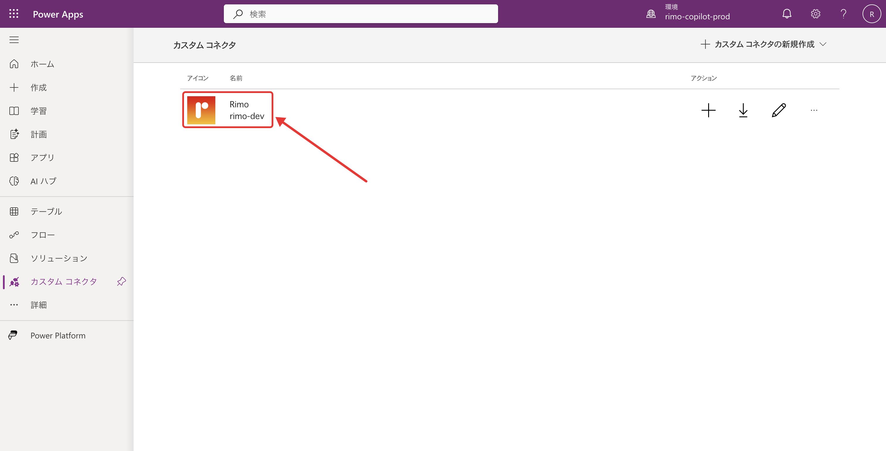

2. Rimo コネクタを開き、**共有（Share）** タブに移動して、組織にアクセス権を付与します — **組織と共有（Share with org）**、またはエージェントを使う全員を含むセキュリティグループを追加します。最後に **保存（Save）** を選びます。

   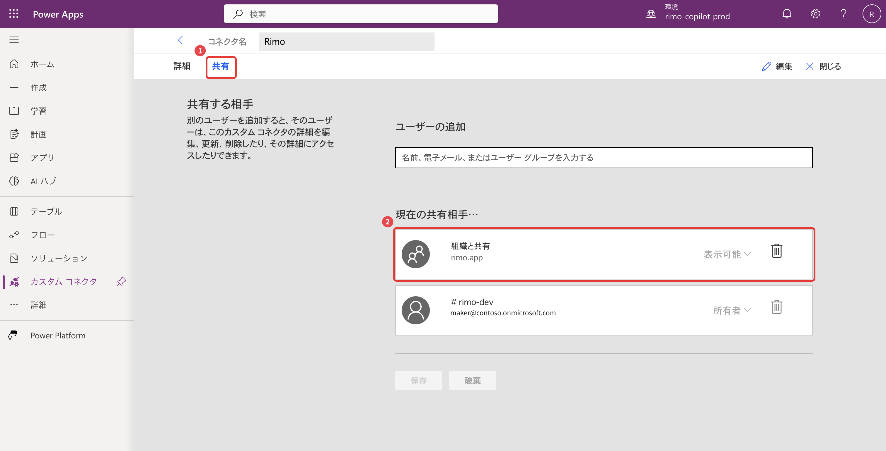

既存の **Power Virtual Agents Service** の項目はそのまま残してください — これはシステムが自動で追加する必須の項目です。削除しないでください。

---

## まずエンドユーザーとして試す

組織全体に提出する前に、通常の従業員と同じ流れでテストします。2 つのアカウントを使います。

- **アカウント A — エージェント作成者/管理者:** 公開が可能な Copilot Studio ライセンス（試用版は不可）、エージェントの環境へのアクセス、および組織への展開も承認する場合は **AI 管理者（AI Administrator）**。
- **アカウント B — 通常のエンドユーザー:** 同じ Entra テナント内の、エージェント作成者/管理者の役割を持たない普通のアカウント。Teams へのアクセスと、自分の Rimo アカウント。

### エージェント作成者 / アカウント A

1. 上部バーの **共有（Share）** アイコンを選びます。**共有** ダイアログが開きます。
2. **Add a name, group, or email**（名前、グループ、メールを追加）に、アカウント B（またはそれを含むセキュリティグループ）を追加します — インストールリンクは、アクセス権を持つユーザーにしか機能しません。
3. **Copy sharing link**（共有リンクをコピー）を選び、アカウント B に送ります。

テナントで Teams への Power Platform アプリの追加が許可されている必要があります。リンクがブロックされる場合は、Teams 管理者にエージェントの許可を依頼してください。

### エンドユーザー / アカウント B

> [!IMPORTANT]
> **サインインのポップアップを許可してください。** **接続（Connect）** を選ぶと、Rimo のサインインがポップアップウィンドウで開きます。ブラウザがブロックした場合は、ブロックされたポップアップを許可すれば Rimo のサインインページが開きます。ブロックしたままだと *「Unable to sign in. Please try again.」* となりサインインできません。

1. エージェントを開き（リンクから、または Microsoft 365 か Teams のエージェントストアで **Rimo** を探して）、**追加（Add）** を選びます。

   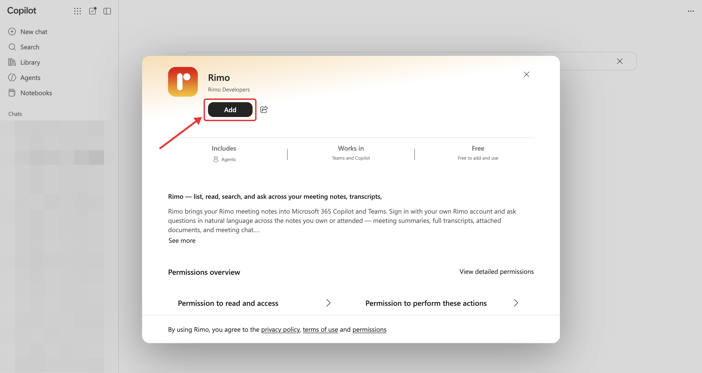

2. *「最近の Rimo のノートを一覧して」* など、Rimo を必要とする質問をします。エージェントが Rimo のカード *「Connect your account, then select "Continue".」*（アカウントを接続してから「Continue」を選んでください）を表示します。**接続（Connect）** を選びます。

   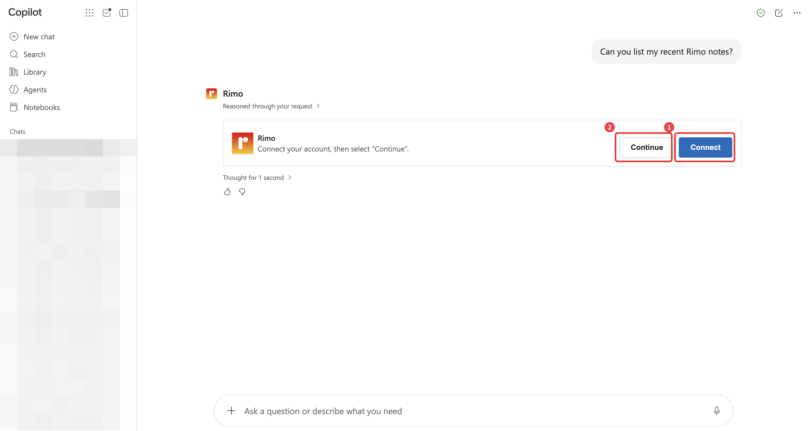

3. 開いたウィンドウで **作成（Create）** を選びます。

   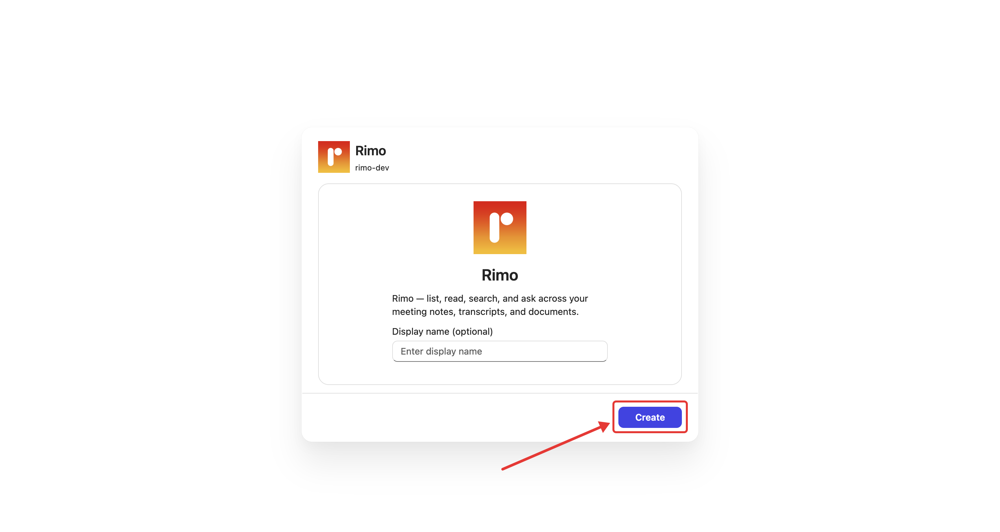

4. **アカウント B 自身の Rimo アカウント** でサインインし、組織を選んで **アクセスを許可（Allow access）** を選びます。

> [!IMPORTANT]
> **サインインのポップアップを許可してください。** この手順で Rimo のサインインがポップアップウィンドウで開きます。ブラウザがブロックした場合は、ブロックされたポップアップを許可すれば Rimo のサインインページが開きます。ブロックしたままだと *「Unable to sign in. Please try again.」* となりサインインできません。

5. チャットに戻り、カードの **Continue**（続行）を選びます。初回は **許可（Allow）** のカードが表示されることがあります — **許可（Allow）** を選びます。するとエージェントがアカウント B のノートを返します。

   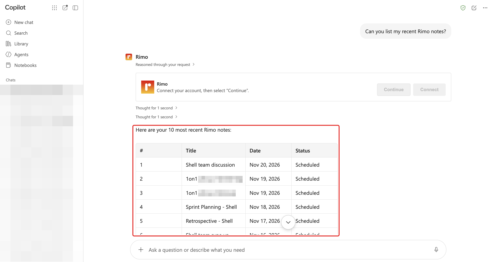

---

## 組織全体に公開する

エンドユーザーでのテストが成功したら、エージェント作成者がエージェントを提出し、管理者が承認します。

### ステップ 1 — エージェント作成者が提出する

1. 上部バーの **共有（Share）** アイコンを選び、**Org-wide sharing for use access**（組織全体で利用可能にする共有）をオンにします。これで全員にエージェントを *使う* 権限が付与されます — これは必須の手順です。エージェントを見つけられても、アクセス権がなければチャットできません。

   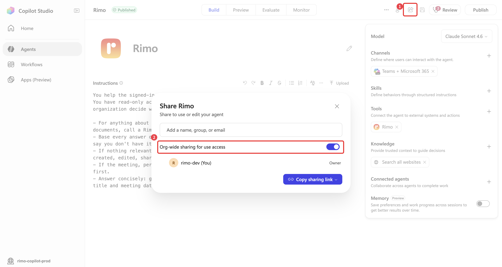

2. 右側パネルの **Teams + Microsoft 365** チャネルを選び、**Use and share**（使用と共有）を開きます。
3. **Share your agent**（エージェントを共有）で **組織カタログに送信（Submit to org catalog）** を選んで確認します。これでエージェントが管理者の承認に送られ、承認されると Microsoft 365 Agent Store の **Built by your org**（Teams では **Built for your org**）に組織全体向けとして掲載されます。

   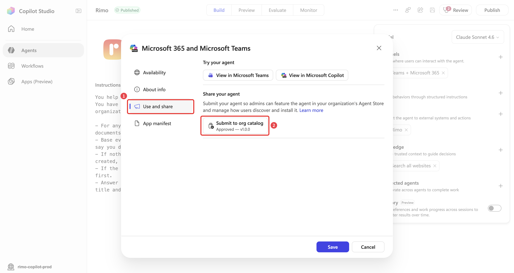

   > **メモ:** 提出後は **Org-wide sharing for use access** をオンのままにしてください。オフにすると、インストール済みのユーザーでもエージェントとチャットできなくなります。

### ステップ 2 — 管理者が承認する

**AI 管理者（AI Administrator）** の役割を持つアカウントで行います。

1. [Microsoft 365 管理センター](https://admin.microsoft.com/) を開き、**エージェント（Agents）→ すべてのエージェント（All agents）→ リクエスト（Requests）** に移動します。

   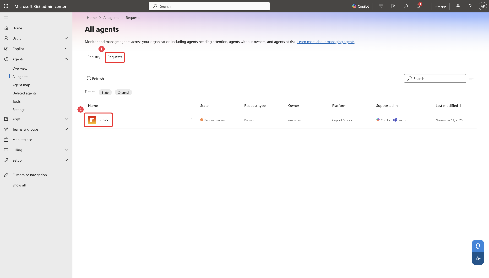

2. 承認待ちの Rimo エージェントを開き、発行元・機能・データアクセス・ツール・セキュリティ・アクセス許可を確認したら、**ストアに公開（Publish to store）** を選んで承認します。

   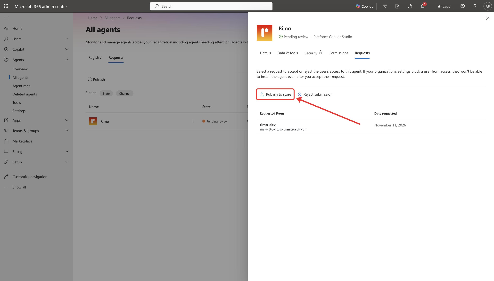

3. **Publish agent to selected users**（選択したユーザーにエージェントを公開）ウィザードで、エージェントをインストールできるユーザー（**All users** または特定のユーザー/グループ）と、事前インストールするユーザー（任意）を選び、残りのステップを **Next**（次へ）で進めて **Publish**（公開）を選びます。

   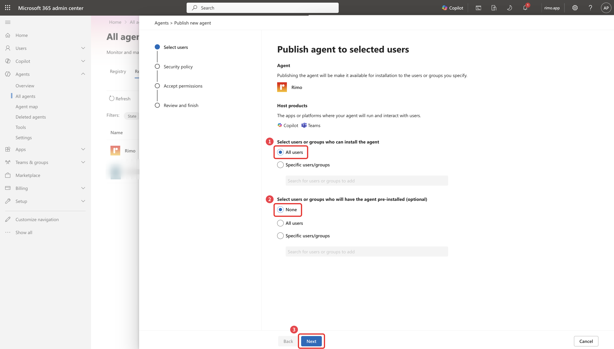

承認後、ユーザーは Teams の **Built for your org**、または Microsoft 365 Agent Store の **Built by your org** からエージェントを見つけられます。Teams 管理者は、選んだユーザーに対してエージェントを自動でインストール・ピン留めすることもできます。

[Microsoft 365 Copilot のエージェントストア](https://learn.microsoft.com/ja-jp/microsoft-365/copilot/copilot-agent-store) と [エージェントの公開範囲を設定する](https://learn.microsoft.com/ja-jp/microsoft-365/copilot/agent-essentials/agent-lifecycle/agent-availability) を参照してください。

---

## 各従業員が行うこと

管理者がエージェントを展開した後、各従業員がすることは次のとおりです。

1. Teams または Microsoft 365 Copilot で Rimo エージェントを開きます（自動展開されていない場合は、先に追加します）。
2. Rimo を必要とする質問をします。
3. 接続して Rimo にサインインし、組織を選んでアクセスを許可します — 一度だけ。

### 初めて使うとき

> [!IMPORTANT]
> **サインインのポップアップを許可してください。** **接続（Connect）** を選ぶと、Rimo のサインインがポップアップウィンドウで開きます。ブラウザがブロックした場合は、ブロックされたポップアップを許可すれば Rimo のサインインページが開きます。ブロックしたままだと *「Unable to sign in. Please try again.」* となりサインインできません。

- Rimo のページで許可した後、チャットに戻って **Continue** を選びます。反応がない場合は **メッセージをもう一度送って** ください — 接続が有効になるまで少し時間がかかります。
- 最初のツール呼び出しでは、一度だけ **アクセス許可が必要（Permission Required）→ 許可（Allow）** のカードが表示されることがあります。許可した後は、以降のメッセージや新しいチャットではプロンプトなしで動作します。

---

## エージェントを更新する

- **内容やツールの変更:** エージェントを再度公開します。既存のユーザーには更新が反映され、通常は組織の再承認は不要です。
- **アイコンや説明などのストア情報:** エージェントを再度、管理者の承認に提出します。
- **新しい Rimo ツールが表示されない:** Copilot Studio で Rimo ツールを開き、接続やツールの検出を更新または作り直してから、再度公開します。

---

## 質問の例

- 「今週の Rimo のノートを見せて。」
- 「先週のスプリントで参加した Rimo のミーティングは？」
- 「直近の Rimo ミーティングの文字起こしを取得して。」
- 「そのミーティングには誰がいた？」
- 「価格戦略に関する Rimo のノートを探して。」
- 「オンボーディングに関するノートを探して。直接オンボーディングという単語がなくても関連するものは含めて。」
- 「Rimo のノートを見て、Q3 リリースについて何を決めたか教えて。」

Rimo は、サインイン中のユーザーが、承認した Rimo 組織の中で閲覧権限のあるものしかエージェントに見せません。

---

## 組織の切り替えと停止

- **一度に 1 つの Rimo 組織。** 別の組織を使うには、接続設定を開いて Rimo を切断し、もう一度接続して、そのときに別の組織を選びます。
- **ユーザーのアクセスを取り消す。** ユーザーは自分の接続ページから Rimo 接続を取り消す、または更新できます。
- **組織のアクセスを停止する。** 管理者は Microsoft 365 管理センターでエージェントをブロック・削除・展開解除できます。
- **エージェントをオフラインにする。** エージェント作成者は Teams と Microsoft 365 Copilot のチャネルを削除できますが、管理者が承認したストアの掲載は管理者が削除する必要があります。

---

## うまくいかないとき

**テストはできるが公開できない。** Copilot Studio の試用版は公開できません。Microsoft 365 Copilot、Copilot Studio クレジットパック（単体）、従量課金、その他の公開が可能なライセンスを使ってください。

**ツールの追加に失敗する。** **OAuth 2.0 → Dynamic (with discovery)** を選んだか、URL が正確に `https://mcp.rimo.app/mcp` かを確認してください。

**エンドユーザーにエージェント作成者の Rimo ノートが見えている。** Rimo ツールを開き、**認証（Authentication）** が **共有アカウント（Shared account）** ではなく **エンド ユーザー アカウント（End user account）** になっているか確認してください。従業員一人ひとりが自分の Rimo 接続を持つ必要があります。

**エンドユーザーに「Connector information unavailable」と表示される。** Rimo カスタムコネクタが共有されていません。組織と共有してください — [Rimo コネクタを組織と共有する](#share-the-rimo-connector-with-your-organization) を参照。

**接続時に「Unable to sign in. Please try again.」と表示される。** ブラウザがサインインのポップアップをブロックしています。接続ページのポップアップを許可して、もう一度 **接続（Connect）** を試してください。

**Rimo のサインインは成功するのに、接続が「Not connected」のまま。** これは、エージェントが専用の（既定以外の）Power Platform 環境にある場合に起こります。この場合、各ユーザーは接続を保存する前に、その環境での役割も必要です。エージェント作成者に依頼して、エージェントの環境でユーザーに **環境作成者（Environment Maker）** の役割を付与してください — 組織全体では、一人ずつではなくセキュリティグループ経由で付与します。

**「継続するにはクレジットが必要です（You need credits to continue）」と表示される（エラーコード `EnforcementUsageCredits`）。** エージェントがある環境に Copilot クレジットがないため、作成・テスト・チャットが止まっています。ユーザーにライセンスを割り当ててもクレジットは増えません。管理者がその環境にクレジットを割り当てるか、従量課金プランをひも付けてください（運用環境とサンドボックス環境のみ）— [Microsoft のプランを選ぶ](#choose-your-microsoft-plan) を参照。反映まで最大 15 分ほどかかることがあります。

**「This agent is currently unavailable. It has reached its usage limit.」と表示される。** 環境の Copilot クレジットを使い切っています。管理者がクレジットを追加で割り当てるか、従量課金プランをひも付けてください — [Microsoft のプランを選ぶ](#choose-your-microsoft-plan) を参照。

**エンドユーザーがエージェントをインストールできない。** 両方の Microsoft アカウントが同じテナントにあること、ユーザーがエージェントのアクセス割り当てに含まれていること、Teams への Power Platform アプリの追加が許可されていること、エージェントが Teams と Microsoft 365 Copilot のチャネルで公開されていることを確認してください。

**エージェントが組織ストアに表示されない。** エージェント作成者の提出だけでは不十分です。AI 管理者が **Microsoft 365 管理センター → エージェント → すべてのエージェント → リクエスト** で承認する必要があります。

---

## Microsoft 公式ヘルプ

- [既存の MCP サーバーを Copilot Studio エージェントに接続する](https://learn.microsoft.com/ja-jp/microsoft-copilot-studio/mcp-add-existing-server-to-agent)
- [ツールのユーザー認証を構成する](https://learn.microsoft.com/ja-jp/microsoft-copilot-studio/configure-enduser-authentication)
- [Copilot Studio のライセンス](https://learn.microsoft.com/ja-jp/microsoft-copilot-studio/billing-licensing)
- [Copilot Studio のハーネス](https://learn.microsoft.com/ja-jp/microsoft-copilot-studio/harnesses-overview)
- [Copilot クレジットの管理](https://learn.microsoft.com/ja-jp/power-platform/admin/manage-copilot-studio-copilot-credits-capacity)
- [ライセンスの割り当てとアクセス管理](https://learn.microsoft.com/ja-jp/microsoft-copilot-studio/requirements-licensing)
- [Teams と Microsoft 365 Copilot に公開する](https://learn.microsoft.com/ja-jp/microsoft-copilot-studio/publication-add-bot-to-microsoft-teams)
- [エージェント管理の役割と権限](https://learn.microsoft.com/ja-jp/microsoft-365/admin/manage/agent-roles-perms?view=o365-worldwide)
- [Microsoft 365 Copilot のエージェントストア](https://learn.microsoft.com/ja-jp/microsoft-365/copilot/copilot-agent-store)

---

## 関連ページ

- [Claude で Rimo を使う](rimo-in-claude.md) — Rimo を Claude につなぐ
- [ChatGPT で Rimo を使う](rimo-in-chatgpt.md) — Rimo を ChatGPT につなぐ
- [Gemini で Rimo を使う](rimo-in-gemini.md) — Rimo を Gemini Spark につなぐ
- [MCP でできること](mcp.md) — 利用できる Rimo のツールと例
- [認証](authentication.md) — Rimo のサインインとアカウントの仕組み
