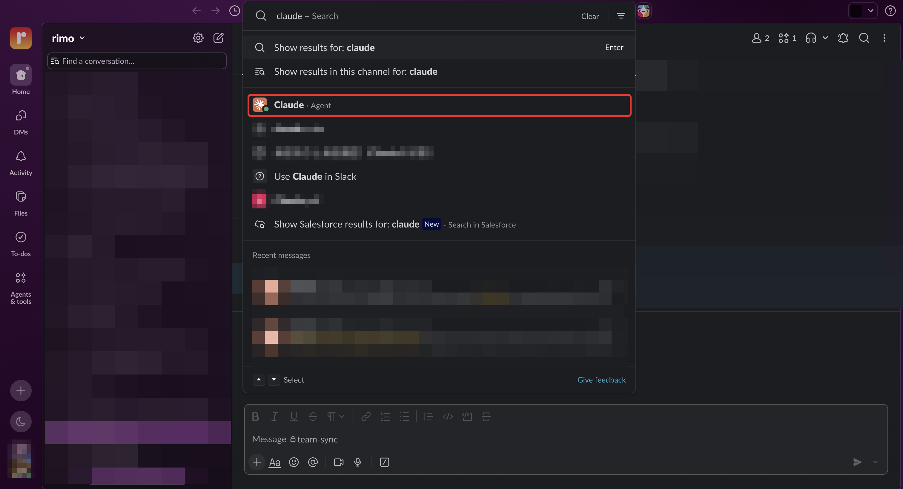
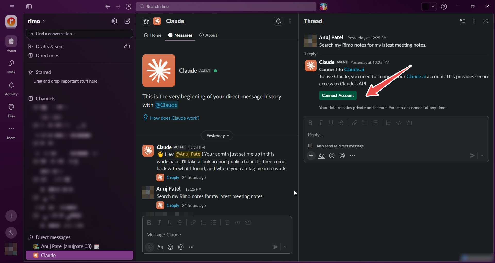
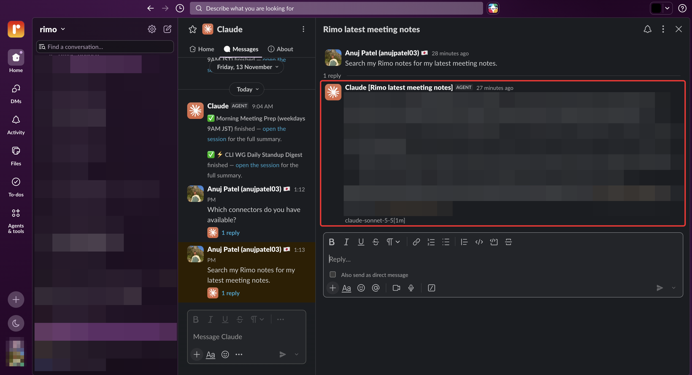
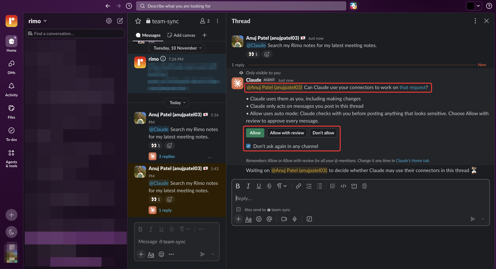

# Slack で Rimo を使う

[English](../en/rimo-in-slack.md) | [日本語](../ja/rimo-in-slack.md)

Slack から、ミーティングについて質問できます。Claude アカウントに **Rimo** コネクタが接続されていれば、Slack で Claude にメッセージを送るだけです — 「価格については何が決まった?」のように尋ねると、Rimo のミーティングノートから読み取った答えが返ってきます。Slack を離れる必要も、Rimo を開く必要もありません。

ミーティングで何が話されたか、何が決まったか、アクションアイテムは何か、誰が出席したか、いつ開催されどれくらいの時間だったか — うろ覚えの過去のミーティングを探すこともできます。[質問の例](#質問の例) を参照してください。

**まずは Claude との DM ではじめてください。** チャンネルで使う前に、コネクタが動作しているかを一番手軽に確認できます。

Claude が動作する場所は 1 つではありません — ブラウザの **claude.ai**、**Claude デスクトップアプリ**、そして **Slack の Claude**（**Claude Tag** とも呼ばれます）。このページでは、そのうち **Slack** での使い方を説明します。

> **チャンネルでは、Claude が Rimo コネクタを使う前に確認を求めます。** **「チャンネルで Rimo を使う」** を参照してください。

> コネクタをはじめて設定する場合は、先に [Claude で Rimo を使う](rimo-in-claude.md) を参照してください。コネクタディレクトリからの接続と Rimo のサインインを説明しています。このページはその続きです。ChatGPT または Microsoft Copilot をお使いですか? [ChatGPT で Rimo を使う](rimo-in-chatgpt.md) または [Microsoft Copilot で Rimo を使う](rimo-in-microsoft.md) を参照してください。自分のマシンのコーディングツール（Claude Code、Cursor、Codex）の場合は [コーディングツールで使う](setup-guide.md) を参照してください。

---

## はじめる前に

- **Rimo アカウント** — いつもサインインしているものと同じ。組織に所属していること。
- **Claude アカウント。** Claude Tag は **Team / Enterprise** プランで利用できます（**ベータ版**）。Claude と DM するには、Claude Code を含むシートが必要です（Enterprise では、Standard シートでの Cowork アクセス、または従量課金の Chat シートでも利用できます）。
- **Claude アプリがインストールされた Slack ワークスペース。** インストールされていない場合は、Slack ワークスペースの管理者が追加する必要があります — [うまくいかないとき](#うまくいかないとき) を参照してください。
- **Claude アカウントに Rimo コネクタが接続されていること** — [Claude で Rimo を使う](rimo-in-claude.md) を参照してください。
- **チャンネルで使う場合は、ワークスペースで Claude Tag が設定済みであること。** 設定できるのは Claude の **プライマリオーナー** または **オーナー** だけで、**Admin** ロールではできません。オーナーでない場合は、Claude ワークスペースの管理者に依頼してください。

> Rimo のパスワードやキーを Claude や Slack に入力することはありません。サインインは、ブラウザ上の Rimo 自身のページで行います。

---

## Slack に Claude をセットアップする

### 1. Slack に Claude アプリをインストールする

[Slack Marketplace](https://claude.com/claude-for-slack) から **Claude** アプリを Slack ワークスペースに追加します。多くのワークスペースでは、アプリをインストールできるのは Slack の管理者だけです。

### 2. Slack で Claude を見つける

Slack で `claude` を検索し、**Claude** アプリを開いてダイレクトメッセージ（DM）をはじめます。

<!-- 暫定: 英語版のスクリーンショットを使用しています。日本語のスクリーンショットが用意できたら ja/slack-find-claude.png に差し替えてください。 -->


### 3. Claude アカウントを接続する

Slack で Claude をはじめて開くとき、Claude アカウントの接続を求められます。案内に従って、**Rimo コネクタを接続した Claude アカウントと同じアカウント** でサインインしてください。別のアカウントだと、設定が完了しているように見えても Rimo が Claude のツールに含まれません。

<!-- 暫定: 英語版のスクリーンショットを使用しています。日本語のスクリーンショットが用意できたら ja/slack-connect-account.png に差し替えてください。 -->


### 4. Rimo コネクタを接続する

コネクタは Slack ではなく **Claude 側の設定** で接続します。まだ接続していない場合は、**[カスタマイズ（Customize）→ コネクタ（Connectors）](https://claude.ai/customize/connectors)** を開いて **Rimo Voice**（Claude のディレクトリでの Rimo コネクタの名前）を接続し、Rimo にサインインして組織を選びます。手順は [Claude で Rimo を使う](rimo-in-claude.md) で説明しています。

同じコネクタが DM でもチャンネルでも使えます。**Team** プランでは、チャンネル用の追加設定は必要ありません。**Enterprise** プランでは、チャンネルでの個人コネクタの扱いを Claude の管理者が管理します。また、組織で Claude Opus 5 が有効になっている必要があります。Claude Opus 5 が必要だと表示された場合は、Claude の管理者に連絡してください。

### 5. Claude が何を参照できるか確認する

DM で次のように尋ねます。

```
使えるコネクタを教えて。
```

一覧に **Rimo Voice** があれば、Claude から Rimo のノートを参照できます。

### 6. 最初の質問をする

DM で、同僚に尋ねるようにミーティングについて聞いてみてください。

```
Rimo のノートから直近のミーティングノートを検索して。
```

Claude がノートを見つけ、どんなミーティングだったか、開催日時、所要時間、参加者、決定事項、自分のアクションアイテムを答えます。

<!-- 暫定: 英語版のスクリーンショットを使用しています。日本語のスクリーンショットが用意できたら ja/slack-rimo-query.png に差し替えてください。 -->


Claude はスレッドで返信し、そのままスレッド内で作業を続けるので、前提を言い直さずに追加の質問ができます。決定事項、アクションアイテム、参加者、特定のトピック、過去のミーティングを掘り起こしたい場合は [質問の例](#質問の例) を参照してください。

チャンネルから聞くこともできます — **「チャンネルで Rimo を使う」** を参照してください。

---

## チャンネルで Rimo を使う

チャンネルでは、あなたが許可すると、Claude は **あなた自身の依頼** にだけ Rimo コネクタを使います。

1. Claude が有効なチャンネルで、**@Claude** にメンションして質問します。

   ```
   @Claude Rimo のノートから直近のミーティングノートを検索して。
   ```

2. 初回は、Claude がスレッド内で（あなたにだけ見える形で）**「Can Claude use your connectors to work on that request?」**（その依頼にあなたのコネクタを使ってよいですか？）と確認します。次のいずれかを選びます。
   - **Allow**（許可）— すぐに作業を開始し、機密に見える内容は投稿前にあなたに確認します。
   - **Allow with review**（レビュー付きで許可）— すべてのメッセージを、投稿前にあなたが承認します。
   - **Don't allow**（許可しない）— この依頼ではあなたのコネクタを使いません。

   **Don't ask again in any channel**（どのチャンネルでも次回から確認しない）にチェックを入れると、**Allow** または **Allow with review** の選択が以降の依頼にも適用されます。あとから変更するには、Slack の Claude アプリの **ホーム** タブにある **Personal connectors in channels**（チャンネルでの個人コネクタ）を開きます。

   <!-- 暫定: 英語版のスクリーンショットを使用しています。日本語のスクリーンショットが用意できたら ja/slack-channel-consent.png に差し替えてください。 -->
   

3. **Allow with review** を選んだ場合は、**Review** をクリックして Claude の下書きを確認し、**Post**（投稿）または **Don't post**（投稿しない）をクリックします。

> **Claude の投稿は、チャンネルの全員に表示されます。** そのノートを Rimo で開けない人にも見えます。共有したくないノートについては DM で質問してください。

Claude があなたのコネクタを使うのは、そのスレッドで **あなた** が投稿したメッセージに対してだけです。同僚の依頼にあなたの Rimo のアクセス権が使われることはありません。スレッドで止めたいときは、Claude のメッセージの下にある **Stop** をクリックします。

チャンネルで Claude がまったく返信しない場合は、**「チャンネルで Claude が返信しない」** を参照してください。

---

## Slack での質問のしかた

**Claude との DM**（および Slack の AI アシスタントのヘッダーから開く Claude のサイドパネル）では、そのまま質問を入力するだけです。メンションは不要です。

**チャンネル** から聞く場合は、確実に質問を拾ってもらうために **@Claude にメンション** してください。スレッドがはじまったら、**あらためて @Claude にメンションする必要はありません。** Claude はスレッドを追いかけ、それまでに聞いた内容の文脈を保持するので、そのまま返信できます。

```
そのアクションアイテムを担当者ごとにまとめて。
```

---

## 質問の例

同僚に尋ねるように、ミーティングについて聞いてください。

- 「このミーティングについて教えて。」
- 「主に何が議論された？」
- 「どんなことが決まった？」
- 「アクションアイテムは？」
- 「このミーティングには誰が出席した？」
- 「このミーティングはどれくらいの時間だった？」
- 「製品ローンチについて何を話した？」
- 「価格については何が決まった？」
- 「Q3 のロードマップを議論したミーティングを探して。」
- 「クライアントとの前回のミーティングで何を話した？」

Slack のメッセージのほうから答えが返ってくるときは、質問のどこかに *Rimo* を入れてください（「Rimo のノート」「直近の Rimo のミーティング」など）。

---

## 制限事項

- **チャンネルでの回答は、チャンネルの全員に表示されます。** 共有したくないノートについては DM で質問してください — **「チャンネルで Rimo を使う」** を参照してください。
- **見えるのは自分のノートだけです。** Rimo は、あなた自身が Rimo で見られるものしか Claude に見せません。同僚から共有されていないノートは表示されません。
- **一度に 1 つの Rimo 組織** — コネクタでサインインした組織のみが対象です。
- **読み取り専用です。** Rimo のツールはすべて読み取りのみで、Claude の操作で Rimo 側のデータが変わることはありません。

---

## うまくいかないとき

### Slack に Claude が見つからない

Claude アプリがワークスペースにインストールされていないか、アプリのインストールが制限されています。**Slack ワークスペースの管理者に連絡** して、Claude アプリの追加または承認を依頼してください。自分の Slack アカウントから有効化できるものではありません。

### アカウントの接続を求められる

Slack で Claude を使うには、先に **Claude アカウント** を接続する必要があります。案内に従って、**Rimo を接続した Claude アカウントと同じアカウント** でサインインしてください。

### 回答はあるが、Rimo のノートの内容ではない

次の順に確認してください。

1. **Rimo を明示的に指定する。** *「Rimo のノートから検索して」*、*「Rimo のノートによると」* のように伝えてください。指定がないと、Claude は Slack の会話だけから答えることがあります。
2. **Claude の DM で試す。** DM では確認なしでコネクタが使われるので、Rimo のアクセス確認に一番手早い方法です。
3. **コネクタを確認する。** Slack が接続している Claude アカウントに **Rimo Voice** が接続されているか、**[カスタマイズ → コネクタ](https://claude.ai/customize/connectors)** で確認してください。
4. **チャンネルでは、自分の選択を確認する。** **Don't allow** を選んだ場合、Claude はあなたのコネクタを使わずに答えます。あらためて @Claude にメンションし、**Allow** または **Allow with review** を選んでください。保存した選択は、Claude アプリの **ホーム** タブの **Personal connectors in channels** で確認できます。

### チャンネルで Claude が返信しない

そのチャンネルで Claude がまだ有効になっていません。Claude の **オーナー** に、**[管理者設定 → Claude Tag](https://claude.ai/admin-settings/claude-tag)** でそのチャンネルの Claude Tag を設定するよう依頼してください。

### 存在するはずのノートを Claude が見つけられない

Claude は、コネクタでサインインした 1 つの組織の中で、あなた自身のアカウントに見えるものしか参照しません。別の組織にあるノートなら、再接続してその組織を選んでください。同僚から共有されていないノートは表示されません。

---

## Claude 公式ヘルプ

- [Claude Tag overview](https://claude.com/docs/claude-tag/overview)
- [What is Claude Tag?](https://support.claude.com/en/articles/15594475-what-is-claude-tag)
- [Personal connectors in channels](https://claude.com/docs/claude-tag/concepts/personal-connectors)
- [Use connectors to extend Claude's capabilities](https://support.claude.com/en/articles/11176164-use-connectors-to-extend-claude-s-capabilities)

---

## 関連ページ

- [Claude で Rimo を使う](rimo-in-claude.md) — Rimo コネクタを接続する（まずはこちら）
- [その他のツールで Rimo を使う](rimo-in-others.md) — Rimo が使えるその他のツール
- [MCP でできること](mcp.md) — 接続後に使えるツールと質問の例
- [ChatGPT で Rimo を使う](rimo-in-chatgpt.md) — ChatGPT 向けの同じ手順
- [Microsoft Copilot で Rimo を使う](rimo-in-microsoft.md) — DCR で Copilot Studio エージェントに接続する
- [認証](authentication.md) — Rimo のサインインとアカウントの仕組み
